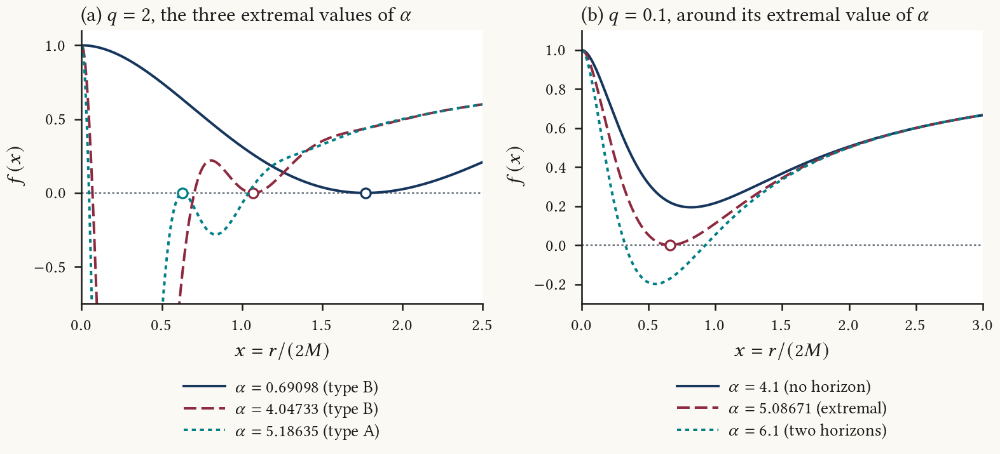

<!-- Author: Dr. Denys Dutykh (Mathematics Department, Khalifa University of Science and Technology, Abu Dhabi, UAE) -->

# LeeWick: quasinormal modes of Lee–Wick black holes by a Chebyshev spectral method



The lapse function f(x) = 1 − h(x)/x of the Lee–Wick black hole, computed from its closed form, with the extremal
configurations found as the assemblers find them, by solving f = 0 and f′ = 0 together. Panel (a), for q = 2, shows the
three values of α at which f has a double root (circles): at α = 0.69098 and α = 4.04733 the double root is the event
horizon (x_e = 1.76785 and 1.06972), an extremal black hole of type B; at α = 5.18635 it lies inside the event horizon
(x_e = 0.62987), which stays simple at x_h = 1.04013, where the dotted curve crosses zero, an extremal black hole of
type A. Panel (b), for q = 0.1, shows no horizon at α = 4.1, a double root at the extremal value α = 5.08671
(x_e = 0.65978), and two horizons at α = 6.1.

LeeWick holds the Maple and MATLAB material of a study of the quasinormal modes of Lee–Wick black holes: the frequencies
at which massless scalar (s = 0), electromagnetic (s = 1) and vector-type gravitational (s = 2) perturbations of these
black holes ring and decay, in the non-extremal case and in the two extremal cases of types A and B. The radial
equation is compactified onto the interval −1 ⩽ y ⩽ 1, the quasinormal boundary conditions are built into a
factorisation of its solution, and the regular part is expanded in Chebyshev polynomials and collocated at the Chebyshev
roots. Three Maple procedures assemble, in multiprecision arithmetic, the matrices of the resulting quadratic eigenvalue
problem, which MATLAB solves with `polyeig`; three Maple worksheets carry the derivations. The method and the results
are those of the article by Davide Batic, Denys Dutykh and Breno L. Giacchini in Physical Review D (2024), cited below.

## The problem

The black hole is static and spherically symmetric, ds² = −f dt² + dr²/f + r² dΩ², and its lapse function, written in
the rescaled radius x = r/(2M), is

```text
f(x) = 1 − h(x)/x,

h(x) = 1 − e^(−αx) [ (1 + α(1 + q²) x/2) cos(αqx) + (1 − q² + α(1 + q²) x) sin(αqx)/(2q) ],

α = 2Ma,    q = b/a,
```

where M is the mass of the source and m = a + ib is the Lee–Wick mass. Depending on q and α, f has no zero, one double
zero, two simple zeros, two simple zeros and a double one, or four simple zeros: Table I of the article lists the cases.
For the values q = 0.1, 0.5 and 1 of the article a single extremal value α_e separates the geometries without horizon
from those with two; for q = 2 there are three extremal values, two of type B, where the event horizon itself is
degenerate, and one of type A, where two inner horizons merge inside a simple event horizon.

With the time dependence e^(−iωt) and spherical harmonics of degree ℓ ⩾ s, each perturbation obeys

```text
f d/dr( f dψ/dr ) + [ ω² − U(r) ] ψ = 0,      U(r) = f(r) [ ε f′(r)/r + ℓ(ℓ + 1)/r² ],      ε = 1 − s²,
```

with ψ ingoing at the event horizon x_h and outgoing at infinity; the dimensionless frequency is Ω = Mω, and Im Ω < 0
for a damped mode. The map y = 1 − 2x_h/x sends the event horizon to y = −1 and infinity to y = +1. After the
asymptotic behaviour at both ends has been factored out, the regular part of ψ is expanded as a(0) T_0(y) + … +
a(n−1) T_(n−1)(y) and the equation is collocated at the n roots y_i = cos((2i − 1)π/(2n)), which gives

```text
( M0 + i Ω M1 + Ω² M2 ) a = 0,
```

with three real n × n matrices. The frequency enters the linear term multiplied by i, so the matrix `M1` exported by
Maple is multiplied by `1i` when the problem is solved. A degenerate event horizon (type B) needs its own
factorisation, written with an auxiliary function η(y) of the compactified variable (section II B of the article); the
type A black hole, whose event horizon is simple, uses the non-extremal formulation.

## Quick start

Each procedure writes its matrices into the folder `data/` of the path it is given, which must exist. In a terminal,
from the folder of the repository:

```bash
mkdir -p data
```

Then, in Maple, read the procedure of the case and call it once per resolution (here a scalar perturbation, ℓ = 1,
with 300 digits, as in the article):

```maple
read "matrixassemblerNonExtreme.mpl":
MatrixAssembler(300, 200, 0, 1, 0.5, 4.0, "/absolute/path/to/LeeWick"):   # q = 0.5, alpha = 4
read "matrixassemblerTypeA.mpl":
MatrixAssembler(300, 200, 0, 1, 2.0, "/absolute/path/to/LeeWick"):        # q = 2 only
read "matrixassemblerTypeB.mpl":
MatrixAssembler(300, 200, 0, 1, 0.1, "/absolute/path/to/LeeWick"):        # q = 0.1 as distributed
```

Each call writes `data/M0_n.mat`, `data/M1_n.mat` and `data/M2_n.mat` in the ASCII format of MATLAB, n being the
number of Chebyshev modes; since the names carry only n, each case is assembled and solved before the next one. The
eigenvalue problem is then solved in MATLAB with the Advanpix Multiprecision Computing Toolbox, from the folder of the
repository (the repository holds no MATLAB file, so these lines are the whole MATLAB side):

```matlab
addpath('/path/to/advanpix');                     % Multiprecision Computing Toolbox
mp.Digits(300);
n  = 200;
M0 = mp.read(sprintf('data/M0_%d.mat', n));
M1 = mp.read(sprintf('data/M1_%d.mat', n));
M2 = mp.read(sprintf('data/M2_%d.mat', n));
Omega = polyeig(M0, mp('1i')*M1, M2);             % (M0 + i Omega M1 + Omega^2 M2) a = 0
plot(real(Omega), imag(Omega), '.')
```

The 2n eigenvalues mix the quasinormal frequencies with artefacts of the truncation. The frequencies are those that stay
in place when n changes: the article overlaps the spectra of n = 200, 250 and 300 and computes with 300 digits.

## The three procedures

All three define a procedure named `MatrixAssembler` and stop with an error if ℓ < s.

| File | Case | Call |
|---|---|---|
| `matrixassemblerNonExtreme.mpl` | non-extremal black hole, and any simple event horizon | `MatrixAssembler(d, n, s, L, q, a, p)` |
| `matrixassemblerTypeA.mpl` | extremal black hole of type A | `MatrixAssembler(d, n, s, L, q, p)` |
| `matrixassemblerTypeB.mpl` | extremal black hole of type B | `MatrixAssembler(d, n, s, L, q, p)` |

The arguments are the number of digits `d` of the computation, the number of Chebyshev modes `n` (the size of the
matrices), the spin `s` (0, 1 or 2), the multipole `L` (that is ℓ), the ratio `q`, the parameter `a` (that is α,
for the non-extremal procedure only) and the path `p` of the folder that holds `data/`. The non-extremal procedure finds
the event horizon as the root of x = h(x) that `fsolve` reaches from x = 2. The two extremal procedures find the double
root x_e and the extremal value of α by solving f = 0 and f′ = 0 together, within search intervals written in the
files. The type A procedure searches 0.1 ⩽ x_e ⩽ 1 and 5 ⩽ α ⩽ 5.5, then the event horizon in 1 ⩽ x_h ⩽ 1.5, and
stops unless it finds the values of q = 2 (x_e = 0.62987, α = 5.18635, x_h = 1.040133223, to 10⁻⁴): it serves q = 2
only. The type B procedure searches 0.5 ⩽ x_e ⩽ 0.8 and 4.9 ⩽ α ⩽ 5.5, which encloses the extremal black hole of
q = 0.1 (x_e = 0.65978, α = 5.08671); the other type B cases of the article (q = 0.5 and 1, and q = 2 at α = 0.69098 or
4.04733) need these intervals edited to enclose their double root, given in Table I of the article. For q = 2 the
distributed intervals enclose the inner double root of the type A black hole, which is not an event horizon.

## Contents

| File | Content |
|---|---|
| `00-f(x).mw` | Maple worksheet: the lapse function f(x), its zeros and the extremal configurations in the plane of q and α |
| `01-NONEXTREME CASE-SUPPLEMENTAL MATERIAL.mw` | Maple worksheet: the derivation for a simple event horizon (non-extremal and type A): change of variables, asymptotic behaviour at both ends, coefficients of the collocated equation |
| `LW-EXTREME CASE-SUPPLEMENTAL MATERIAL.mw` | Maple worksheet: the same derivation for a degenerate event horizon (type B), with the function η(y) |
| `matrixassembler*.mpl` | the three Maple procedures described above |
| `docs/figures/` | the script `plot_readme_figure.py` that draws the figure of this page from the closed form of f, with the style file beside it |

## Requirements

Maple 18 or later for the worksheets, which are saved by Maple 18, and for the procedures, which use only
`LinearAlgebra`, `ChebyshevT`, `fsolve` and `ExportMatrix`. MATLAB with the Advanpix Multiprecision Computing Toolbox
(a commercial toolbox) for the eigenvalue problem: the article computes with 300 digits and reports that in double
precision the spectra are distorted and inaccurate beyond the first few modes. The figure of this page needs Python 3
with NumPy, SciPy and Matplotlib, and is redrawn from `docs/figures/` by `python3 plot_readme_figure.py`.

## How to cite

If you use this code, please cite the article:

D. Batic, D. Dutykh and B. L. Giacchini, Unified spectral approach for quasinormal modes of Lee–Wick black holes,
Physical Review D 110, 084032 (2024).

https://doi.org/10.1103/PhysRevD.110.084032

```bibtex
@article{Batic2024b,
  author = {Batic, Davide and Dutykh, Denys and Giacchini, Breno L.},
  title = {Unified Spectral Approach for Quasinormal Modes of {{Lee-Wick}} Black Holes},
  journal = {Physical Review D},
  year = 2024,
  month = oct,
  volume = {110},
  number = {8},
  pages = {084032},
  doi = {10.1103/PhysRevD.110.084032},
  eprint = {2410.13245},
  archiveprefix = {arXiv}
}
```

The button "Cite this repository" in the right-hand column of this page gives the same reference, read from
`CITATION.cff`. A free copy of the article is on arXiv:

https://arxiv.org/abs/2410.13245

## Licence

GNU Lesser General Public License, version 2.1 (see `LICENSE`).

## Authors

Davide Batic and Denys Dutykh (Mathematics Department, Khalifa University of Science and Technology, Abu Dhabi) and
Breno L. Giacchini (Institute of Theoretical Physics, Charles University, Prague). The article is listed, with the other
studies of quasinormal modes of the same group, in the [Quasi-Normal Modes Hall of Fame](https://qnms.denys-dutykh.com/).

https://www.denys-dutykh.com/
